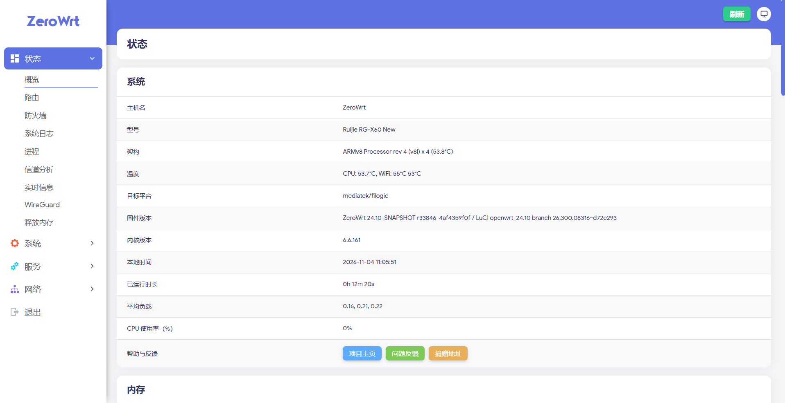

<div align="center">

# ZeroWrt for Ruijie RG-X60 New

基于 OpenWrt 24.10 的锐捷 RG-X60 New 定制固件，面向 MediaTek Filogic 平台优化，开箱即用。

[](https://github.com/MinimaxFlora/MediaTek_Firmware/releases/tag/20261104)
[](https://openwrt.org/)
[](https://www.kernel.org/)
[](https://openwrt.org/docs/techref/targets/mediatek)
[](LICENSE)

简体中文 | [English](README_EN.md)

</div>

---

## 项目简介

本仓库用于发布 **ZeroWrt** 锐捷 RG-X60 New 固件。固件基于 OpenWrt 24.10 分支构建，集成 Argon 主题、OpenClash、PassWall、SmartDNS、TurboACC-MTK、EQOS-MTK 等常用组件，并针对 MediaTek Filogic 平台做了网络加速与无线驱动适配。

系统默认启用简体中文界面，适合追求稳定、易用与可玩性的家庭路由场景。

## 界面预览

| 登录界面 | 首页 |
| :---: | :---: |
| <a href="./docs/images/login-page.webp"></a> | <a href="./docs/images/home-page.png"></a> |
| Argon 主题登录页面 | 状态总览：系统信息、温度、负载与内存 |

> 截图来自 Argon 主题，实际外观可在「系统 - 语言和界面」中切换。

## 固件信息

| 项目 | 内容 |
| :--- | :--- |
| 固件名称 | ZeroWrt |
| 固件版本 | 24.10-SNAPSHOT r33846-4af4359f0f |
| 发布版本 | 20261104 |
| 发布日期 | 2026-11-04 |
| 目标平台 | `mediatek/filogic` |
| 处理器架构 | ARMv8 Cortex-A53 x4（`aarch64_cortex-a53`） |
| 内核版本 | 6.6.161 |
| LuCI 分支 | openwrt-24.10 `26.300.08316~d72e293` |
| 默认主题 | Argon 3.1.2（内置 Bootstrap） |
| 默认语言 | 简体中文 |
| 软件源 | ImmortalWrt packages / luci，OpenWrt routing / telephony |
| 许可证 | GNU General Public License v3.0 |

## 硬件与设备

| 项目 | 内容 |
| :--- | :--- |
| 设备型号 | 锐捷 RG-X60 New（Ruijie RG-X60 New） |
| 设备标识 | `ruijie,rg-x60-new` |
| 主控平台 | MediaTek MT7986（Filogic 830） |
| 无线方案 | MediaTek MT7986 Wi-Fi 6，`kmod-mt_wifi 7.6.6.1-mt7986` |
| 有线交换 | 集成千兆交换，支持 HNAT 硬件加速 |
| 目标架构 | `aarch64_cortex-a53` |

> 内存、闪存与接口配置请以实机为准。不同批次硬件可能存在差异，刷机前请确认设备型号与分区布局。

## 支持的固件布局

当前发布包含四个 profile，对应不同的 Bootloader 与分区布局。选择错误的镜像可能导致设备无法启动，请务必先确认设备当前布局。

| Profile | 镜像前缀 | 说明 |
| :--- | :--- | :--- |
| 标准布局 | `zerowrt-mediatek-filogic-ruijie_rg-x60-new` | 常规 OpenWrt 分区布局 |
| 原厂布局 | `zerowrt-mediatek-filogic-ruijie_rg-x60-new-stock` | 保留原厂 Bootloader / 分区结构 |
| 扩容布局 | `zerowrt-mediatek-filogic-ruijie_rg-x60-new-expand` | 扩展 rootfs 可用空间 |
| U-Boot 布局 | `zerowrt-mediatek-filogic-ruijie_rg-x60-new-ubootmod` | 已刷 OpenWrt U-Boot 的设备 |

## 下载

完整文件列表请前往 [Release 20261104](https://github.com/MinimaxFlora/MediaTek_Firmware/releases/tag/20261104)。

### 常规镜像

| 文件 | 类型 | 大小 | 下载 |
| :--- | :--- | ---: | :---: |
| `zerowrt-mediatek-filogic-ruijie_rg-x60-new-squashfs-sysupgrade.bin` | 标准布局 / 系统升级 | 40.6 MB | [下载](https://github.com/MinimaxFlora/MediaTek_Firmware/releases/download/20261104/zerowrt-mediatek-filogic-ruijie_rg-x60-new-squashfs-sysupgrade.bin) |
| `zerowrt-mediatek-filogic-ruijie_rg-x60-new-initramfs-kernel.bin` | 标准布局 / 临时系统 | 35.4 MB | [下载](https://github.com/MinimaxFlora/MediaTek_Firmware/releases/download/20261104/zerowrt-mediatek-filogic-ruijie_rg-x60-new-initramfs-kernel.bin) |
| `zerowrt-mediatek-filogic-ruijie_rg-x60-new-stock-squashfs-sysupgrade.bin` | 原厂布局 / 系统升级 | 40.6 MB | [下载](https://github.com/MinimaxFlora/MediaTek_Firmware/releases/download/20261104/zerowrt-mediatek-filogic-ruijie_rg-x60-new-stock-squashfs-sysupgrade.bin) |
| `zerowrt-mediatek-filogic-ruijie_rg-x60-new-stock-initramfs-kernel.bin` | 原厂布局 / 临时系统 | 35.4 MB | [下载](https://github.com/MinimaxFlora/MediaTek_Firmware/releases/download/20261104/zerowrt-mediatek-filogic-ruijie_rg-x60-new-stock-initramfs-kernel.bin) |
| `zerowrt-mediatek-filogic-ruijie_rg-x60-new-expand-squashfs-sysupgrade.bin` | 扩容布局 / 系统升级 | 40.6 MB | [下载](https://github.com/MinimaxFlora/MediaTek_Firmware/releases/download/20261104/zerowrt-mediatek-filogic-ruijie_rg-x60-new-expand-squashfs-sysupgrade.bin) |
| `zerowrt-mediatek-filogic-ruijie_rg-x60-new-expand-initramfs-kernel.bin` | 扩容布局 / 临时系统 | 35.4 MB | [下载](https://github.com/MinimaxFlora/MediaTek_Firmware/releases/download/20261104/zerowrt-mediatek-filogic-ruijie_rg-x60-new-expand-initramfs-kernel.bin) |

### U-Boot 布局镜像

| 文件 | 类型 | 大小 | 下载 |
| :--- | :--- | ---: | :---: |
| `zerowrt-mediatek-filogic-ruijie_rg-x60-new-ubootmod-squashfs-sysupgrade.itb` | 系统升级 | 42.2 MB | [下载](https://github.com/MinimaxFlora/MediaTek_Firmware/releases/download/20261104/zerowrt-mediatek-filogic-ruijie_rg-x60-new-ubootmod-squashfs-sysupgrade.itb) |
| `zerowrt-mediatek-filogic-ruijie_rg-x60-new-ubootmod-initramfs-recovery.itb` | 恢复系统 | 35.4 MB | [下载](https://github.com/MinimaxFlora/MediaTek_Firmware/releases/download/20261104/zerowrt-mediatek-filogic-ruijie_rg-x60-new-ubootmod-initramfs-recovery.itb) |
| `zerowrt-mediatek-filogic-ruijie_rg-x60-new-ubootmod-preloader.bin` | Preloader | 201 KB | [下载](https://github.com/MinimaxFlora/MediaTek_Firmware/releases/download/20261104/zerowrt-mediatek-filogic-ruijie_rg-x60-new-ubootmod-preloader.bin) |
| `zerowrt-mediatek-filogic-ruijie_rg-x60-new-ubootmod-bl31-uboot.fip` | BL31 + U-Boot | 1.03 MB | [下载](https://github.com/MinimaxFlora/MediaTek_Firmware/releases/download/20261104/zerowrt-mediatek-filogic-ruijie_rg-x60-new-ubootmod-bl31-uboot.fip) |

### 校验与元数据

| 文件 | 说明 | 下载 |
| :--- | :--- | :---: |
| `sha256sums` | 全部镜像的 SHA256 校验值 | [下载](https://github.com/MinimaxFlora/MediaTek_Firmware/releases/download/20261104/sha256sums) |
| `profiles.json` | 设备 profile 与镜像元数据 | [下载](https://github.com/MinimaxFlora/MediaTek_Firmware/releases/download/20261104/profiles.json) |
| `config.buildinfo` | 构建配置 | [下载](https://github.com/MinimaxFlora/MediaTek_Firmware/releases/download/20261104/config.buildinfo) |
| `feeds.buildinfo` | 软件源版本锁定信息 | [下载](https://github.com/MinimaxFlora/MediaTek_Firmware/releases/download/20261104/feeds.buildinfo) |
| `zerowrt-mediatek-filogic.manifest` | 已安装软件包清单 | [下载](https://github.com/MinimaxFlora/MediaTek_Firmware/releases/download/20261104/zerowrt-mediatek-filogic.manifest) |

下载后建议先校验文件完整性：

```bash
# 下载校验文件与目标镜像后，在同一目录执行
sha256sum -c sha256sums --ignore-missing
```

## 快速开始


1. 根据设备当前布局选择对应的 `sysupgrade` 镜像。
2. 使用 `sha256sums` 校验文件完整性。
3. 在 LuCI 中进入「系统 - 备份/升级 - 刷写新固件」，选择镜像并确认刷写。
4. 跨布局刷机时取消勾选「保留配置」，避免残留配置导致异常。
5. 设备重启后访问管理后台完成初始化。

默认管理信息：

| 项目 | 默认值 |
| :--- | :--- |
| 管理地址 | `http://192.168.1.1` |
| 用户名 | `root` |
| 初始密码 | 通常为空，以实际固件为准 |
| SSH | 默认开启，端口 `22` |

> 首次登录后请立即修改管理员密码，并按需调整 LAN 地址、WAN 拨号与无线配置。

## 刷机说明

### 已在 OpenWrt / ZeroWrt 上

直接使用对应布局的 `sysupgrade` 镜像升级。同一布局升级可保留配置；跨布局或出现异常时建议不保留配置。

### 从原厂固件首次刷入

通常需要先通过 `initramfs` 镜像进入临时系统，再写入 `sysupgrade` 镜像。进入临时系统的方式取决于设备 Bootloader，请先确认设备已具备刷机条件并做好原厂固件备份。

### OpenWrt U-Boot 布局

`ubootmod` 需要先写入 `preloader` 与 `bl31-uboot.fip`，再通过恢复镜像进入系统并刷入 `sysupgrade.itb`。该流程涉及 Bootloader，操作失误可能导致设备变砖，请确认每一步都与设备匹配。

> 刷机有风险。请提前备份原厂固件与分区，并确保供电稳定。因刷机导致的设备损坏或数据丢失需自行承担。

## 功能特性

| 模块 | 组件 | 说明 |
| :--- | :--- | :--- |
| 界面主题 | Argon 3.1.2、Bootstrap、Argon 配置 | 现代化 LuCI 主题，支持深浅色与自定义背景 |
| 网络代理 | OpenClash 0.48.002 | 基于 Clash 内核的策略分流与订阅管理 |
| 网络代理 | PassWall 26.11.3 | 集成 Xray、SmartDNS、Geoview 与 nftables 透明代理 |
| 代理内核 | Xray-core 26.10.31 | 高性能代理内核 |
| DNS | SmartDNS 48.4、chinadns-ng、dnsmasq-full | 分流解析、缓存加速与国内直连优化 |
| 网络加速 | TurboACC-MTK、HNAT、FullCone NAT、BBR | 硬件 NAT 加速、全锥形 NAT 与拥塞控制优化 |
| 流量控制 | EQOS-MTK、SQM（cake） | 智能限速与队列整形，降低缓冲膨胀 |
| 网络服务 | UPnP、DDNS、ACME、WireGuard | 端口映射、动态域名、证书申请与 VPN 接入 |
| 系统工具 | ttyd、htop、bash、curl、tcpdump | Web 终端与常用排障工具 |
| 存储支持 | ext4、NTFS3、exFAT、Btrfs、zram-swap | 外接存储与内存压缩交换 |
| 实用插件 | Wrtbwmon、RAMFree、3cat、ARP Bind、Commands | 流量统计、内存释放、定时任务与命令面板 |

## 已集成软件包（节选）

| 类别 | 软件包 |
| :--- | :--- |
| 系统 | `base-files 1863~4af4359f0f`、`busybox 1.36.1`、`bash 5.2.37`、`procd-ujail` |
| 内核模块 | `kmod-mt_wifi 7.6.6.1-mt7986`、`kmod-mediatek_hnat`、`kmod-wireguard`、`kmod-zram` |
| 防火墙 | `firewall4`、`nftables 1.1.1`、`kmod-nft-offload`、`kmod-ipt-fullconenat` |
| 代理 | `luci-app-openclash`、`luci-app-passwall`、`xray-core`、`smartdns`、`chinadns-ng` |
| 主题 | `luci-theme-argon 3.1.2-r20261102`、`luci-app-argon-config`、`luci-theme-bootstrap` |
| 工具 | `ttyd 1.7.3`、`htop 3.5.3`、`curl 8.22.0`、`tcpdump 4.99.5`、`usbutils` |

完整清单请查看 Release 中的 `zerowrt-mediatek-filogic.manifest`。

## 常见问题

<details>
<summary>忘记管理密码怎么办？</summary>

在设备开机后通过复位按键恢复出厂设置，或通过 SSH / 串口进入系统后执行 `passwd` 重新设置密码。恢复出厂设置会清除现有配置，请提前备份。
</details>

<details>
<summary>刷入后无法启动或无限重启？</summary>

优先检查镜像布局是否与设备当前 Bootloader 匹配。标准、原厂、扩容与 U-Boot 布局互不通用，跨布局刷机会导致无法启动。确认布局后重新进入恢复模式刷写正确镜像。
</details>

<details>
<summary>系统空间不足怎么处理？</summary>

使用 `expand` 扩容布局镜像重新刷写，可扩展 rootfs 可用空间。刷写前请备份配置，扩容操作通常会重建分区。
</details>

<details>
<summary>如何升级到新版本？</summary>

在同一布局下使用新的 `sysupgrade` 镜像升级，并勾选保留配置即可。跨大版本升级建议先备份配置，再选择不保留配置刷写。
</details>

<details>
<summary>无线信号或速率不理想？</summary>

确认无线国家/地区与信道设置正确，并根据环境调整频宽与功率。MT7986 平台建议启用硬件加速并使用 160 MHz 频宽（需终端支持）。
</details>

<details>
<summary>温度显示偏高是否正常？</summary>

Filogic 平台在高负载或封闭环境下温度会升高。保持通风，避免叠放；如温度持续异常，请检查散热与负载情况。
</details>

## 构建信息

| 项目 | 内容 |
| :--- | :--- |
| 源码基线 | OpenWrt 24.10 / ImmortalWrt 软件源 |
| packages | `immortalwrt/packages@841b9ee7152af411a0761a08057408fcded37051` |
| luci | `immortalwrt/luci@d72e293e6fd698af75510b9018fb7e154ae219cc` |
| routing | `openwrt/routing@00619bc7bc60d8b67ecc490121e45298b122cd6e` |
| telephony | `openwrt/telephony@695f4f4a733dfaf10922d24bf9dbdfd509b8a6d4` |
| 构建标识 | `r33846-4af4359f0f` |

## 致谢

- [OpenWrt](https://openwrt.org/)
- [ImmortalWrt](https://github.com/immortalwrt)
- [luci-theme-argon](https://github.com/jerrykuku/luci-theme-argon)
- [OpenClash](https://github.com/vernesong/OpenClash)
- [PassWall](https://github.com/xiaorouji/openwrt-passwall)
- [SmartDNS](https://github.com/pymumu/smartdns)
- 以及所有上游开源项目的贡献者

## 许可证

本项目基于 [GNU General Public License v3.0](LICENSE) 发布。

## 免责声明

固件按「现状」提供，不附带任何明示或暗示的担保。刷机、超频、修改分区等操作存在风险，可能导致设备损坏、数据丢失或保修失效。请在充分了解风险并做好备份后操作，并遵守当地法律法规。

<div align="center">

[返回顶部](#zerowrt-for-ruijie-rg-x60-new) | [English](README_EN.md)

</div>
