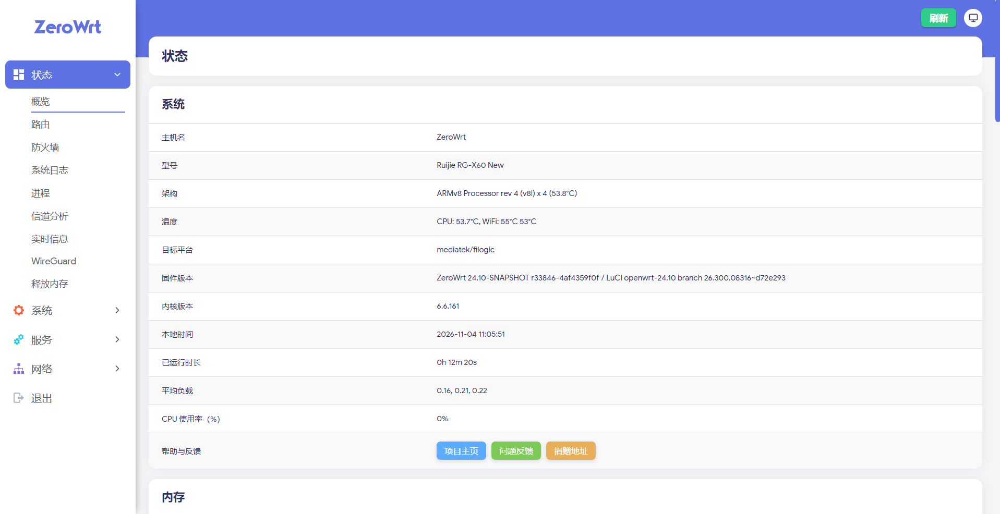

<div align="center">

# ZeroWrt for Ruijie RG-X60 New

A custom OpenWrt 24.10 firmware for the Ruijie RG-X60 New, tuned for the MediaTek Filogic platform and ready to use out of the box.

[](https://github.com/MinimaxFlora/MediaTek_Firmware/releases/tag/20261104)
[](https://openwrt.org/)
[](https://www.kernel.org/)
[](https://openwrt.org/docs/techref/targets/mediatek)
[](LICENSE)

[简体中文](README.md) | English

</div>

---

## Overview

This repository publishes **ZeroWrt** firmware for the Ruijie RG-X60 New. The firmware is built from the OpenWrt 24.10 branch, ships with the Argon theme, OpenClash, PassWall, SmartDNS, TurboACC-MTK, EQOS-MTK and other common components, and includes network acceleration and wireless driver tuning for the MediaTek Filogic platform.

Simplified Chinese is enabled by default, making it a practical choice for stable, easy-to-manage home routing.

## Interface Preview

| Login Page | Home Page |
| :---: | :---: |
| <a href="./docs/images/login-page.webp"></a> | <a href="./docs/images/home-page.png"></a> |
| Argon theme login page | Status overview: system info, temperature, load and memory |

> Screenshots use the Argon theme. The active theme can be changed under System - Language and Interface.

## Firmware Information

| Item | Value |
| :--- | :--- |
| Firmware name | ZeroWrt |
| Firmware version | 24.10-SNAPSHOT r33846-4af4359f0f |
| Release tag | 20261104 |
| Release date | 2026-11-04 |
| Target | `mediatek/filogic` |
| CPU architecture | ARMv8 Cortex-A53 x4 (`aarch64_cortex-a53`) |
| Kernel | 6.6.161 |
| LuCI branch | openwrt-24.10 `26.300.08316~d72e293` |
| Default theme | Argon 3.1.2 (Bootstrap included) |
| Default language | Simplified Chinese |
| Package feeds | ImmortalWrt packages / luci, OpenWrt routing / telephony |
| License | GNU General Public License v3.0 |

## Hardware and Device

| Item | Value |
| :--- | :--- |
| Device model | Ruijie RG-X60 New |
| Device identifier | `ruijie,rg-x60-new` |
| SoC platform | MediaTek MT7986 (Filogic 830) |
| Wireless | MediaTek MT7986 Wi-Fi 6, `kmod-mt_wifi 7.6.6.1-mt7986` |
| Ethernet switch | Integrated gigabit switch with HNAT hardware acceleration |
| Target architecture | `aarch64_cortex-a53` |

> Memory, flash and port configuration depend on the actual unit. Hardware revisions may differ. Confirm the model and partition layout before flashing.

## Supported Layouts

This release contains four profiles covering different bootloader and partition layouts. Flashing the wrong image can prevent the device from booting, so confirm the current layout first.

| Profile | Image prefix | Description |
| :--- | :--- | :--- |
| Standard | `zerowrt-mediatek-filogic-ruijie_rg-x60-new` | Regular OpenWrt partition layout |
| Stock | `zerowrt-mediatek-filogic-ruijie_rg-x60-new-stock` | Keeps the stock bootloader and partition structure |
| Expand | `zerowrt-mediatek-filogic-ruijie_rg-x60-new-expand` | Expands available rootfs space |
| U-Boot | `zerowrt-mediatek-filogic-ruijie_rg-x60-new-ubootmod` | For devices already running OpenWrt U-Boot |

## Download

See [Release 20261104](https://github.com/MinimaxFlora/MediaTek_Firmware/releases/tag/20261104) for the full file list.

### Standard Images

| File | Type | Size | Download |
| :--- | :--- | ---: | :---: |
| `zerowrt-mediatek-filogic-ruijie_rg-x60-new-squashfs-sysupgrade.bin` | Standard / sysupgrade | 40.6 MB | [Download](https://github.com/MinimaxFlora/MediaTek_Firmware/releases/download/20261104/zerowrt-mediatek-filogic-ruijie_rg-x60-new-squashfs-sysupgrade.bin) |
| `zerowrt-mediatek-filogic-ruijie_rg-x60-new-initramfs-kernel.bin` | Standard / temporary system | 35.4 MB | [Download](https://github.com/MinimaxFlora/MediaTek_Firmware/releases/download/20261104/zerowrt-mediatek-filogic-ruijie_rg-x60-new-initramfs-kernel.bin) |
| `zerowrt-mediatek-filogic-ruijie_rg-x60-new-stock-squashfs-sysupgrade.bin` | Stock / sysupgrade | 40.6 MB | [Download](https://github.com/MinimaxFlora/MediaTek_Firmware/releases/download/20261104/zerowrt-mediatek-filogic-ruijie_rg-x60-new-stock-squashfs-sysupgrade.bin) |
| `zerowrt-mediatek-filogic-ruijie_rg-x60-new-stock-initramfs-kernel.bin` | Stock / temporary system | 35.4 MB | [Download](https://github.com/MinimaxFlora/MediaTek_Firmware/releases/download/20261104/zerowrt-mediatek-filogic-ruijie_rg-x60-new-stock-initramfs-kernel.bin) |
| `zerowrt-mediatek-filogic-ruijie_rg-x60-new-expand-squashfs-sysupgrade.bin` | Expand / sysupgrade | 40.6 MB | [Download](https://github.com/MinimaxFlora/MediaTek_Firmware/releases/download/20261104/zerowrt-mediatek-filogic-ruijie_rg-x60-new-expand-squashfs-sysupgrade.bin) |
| `zerowrt-mediatek-filogic-ruijie_rg-x60-new-expand-initramfs-kernel.bin` | Expand / temporary system | 35.4 MB | [Download](https://github.com/MinimaxFlora/MediaTek_Firmware/releases/download/20261104/zerowrt-mediatek-filogic-ruijie_rg-x60-new-expand-initramfs-kernel.bin) |

### U-Boot Layout Images

| File | Type | Size | Download |
| :--- | :--- | ---: | :---: |
| `zerowrt-mediatek-filogic-ruijie_rg-x60-new-ubootmod-squashfs-sysupgrade.itb` | Sysupgrade | 42.2 MB | [Download](https://github.com/MinimaxFlora/MediaTek_Firmware/releases/download/20261104/zerowrt-mediatek-filogic-ruijie_rg-x60-new-ubootmod-squashfs-sysupgrade.itb) |
| `zerowrt-mediatek-filogic-ruijie_rg-x60-new-ubootmod-initramfs-recovery.itb` | Recovery system | 35.4 MB | [Download](https://github.com/MinimaxFlora/MediaTek_Firmware/releases/download/20261104/zerowrt-mediatek-filogic-ruijie_rg-x60-new-ubootmod-initramfs-recovery.itb) |
| `zerowrt-mediatek-filogic-ruijie_rg-x60-new-ubootmod-preloader.bin` | Preloader | 201 KB | [Download](https://github.com/MinimaxFlora/MediaTek_Firmware/releases/download/20261104/zerowrt-mediatek-filogic-ruijie_rg-x60-new-ubootmod-preloader.bin) |
| `zerowrt-mediatek-filogic-ruijie_rg-x60-new-ubootmod-bl31-uboot.fip` | BL31 + U-Boot | 1.03 MB | [Download](https://github.com/MinimaxFlora/MediaTek_Firmware/releases/download/20261104/zerowrt-mediatek-filogic-ruijie_rg-x60-new-ubootmod-bl31-uboot.fip) |

### Checksums and Metadata

| File | Description | Download |
| :--- | :--- | :---: |
| `sha256sums` | SHA256 checksums for all images | [Download](https://github.com/MinimaxFlora/MediaTek_Firmware/releases/download/20261104/sha256sums) |
| `profiles.json` | Device profiles and image metadata | [Download](https://github.com/MinimaxFlora/MediaTek_Firmware/releases/download/20261104/profiles.json) |
| `config.buildinfo` | Build configuration | [Download](https://github.com/MinimaxFlora/MediaTek_Firmware/releases/download/20261104/config.buildinfo) |
| `feeds.buildinfo` | Pinned package feed revisions | [Download](https://github.com/MinimaxFlora/MediaTek_Firmware/releases/download/20261104/feeds.buildinfo) |
| `zerowrt-mediatek-filogic.manifest` | Installed package manifest | [Download](https://github.com/MinimaxFlora/MediaTek_Firmware/releases/download/20261104/zerowrt-mediatek-filogic.manifest) |

Verify file integrity after downloading:

```bash
# Run in the same directory as the checksum file and target image
sha256sum -c sha256sums --ignore-missing
```

## Quick Start


1. Pick the `sysupgrade` image that matches the current layout.
2. Verify integrity with `sha256sums`.
3. In LuCI, go to System - Backup / Flash Firmware, select the image and confirm.
4. When switching layouts, uncheck "Keep settings" to avoid stale configuration issues.
5. After reboot, open the admin page and finish initialization.

Default access:

| Item | Default |
| :--- | :--- |
| Admin URL | `http://192.168.1.1` |
| Username | `root` |
| Initial password | Usually empty; follow the actual firmware |
| SSH | Enabled by default on port `22` |

> Change the admin password immediately after the first login, then adjust the LAN address, WAN dial-up and wireless settings as needed.

## Flashing Notes

### Upgrading from OpenWrt / ZeroWrt

Use the `sysupgrade` image for the matching layout. Upgrades within the same layout can keep settings; when switching layouts or troubleshooting, start fresh without keeping settings.

### First Install from Stock Firmware

The usual path is to boot the `initramfs` image into a temporary system, then write the `sysupgrade` image. How you enter the temporary system depends on the bootloader. Confirm the device is ready and back up the stock firmware first.

### OpenWrt U-Boot Layout

The `ubootmod` path requires writing `preloader` and `bl31-uboot.fip` first, then booting the recovery image and flashing `sysupgrade.itb`. This touches the bootloader, so mistakes can brick the device. Verify each step against your hardware.

> Flashing carries risk. Back up the stock firmware and partitions, and keep power stable. Any device damage or data loss is your own responsibility.

## Features

| Area | Component | Description |
| :--- | :--- | :--- |
| UI theme | Argon 3.1.2, Bootstrap, Argon Config | Modern LuCI theme with light/dark modes and custom backgrounds |
| Proxy | OpenClash 0.48.002 | Clash-based policy routing and subscription management |
| Proxy | PassWall 26.11.3 | Xray, SmartDNS, Geoview and nftables transparent proxy integration |
| Proxy core | Xray-core 26.10.31 | High-performance proxy core |
| DNS | SmartDNS 48.4, chinadns-ng, dnsmasq-full | Split DNS, cache acceleration and direct-connect optimization |
| Acceleration | TurboACC-MTK, HNAT, FullCone NAT, BBR | Hardware NAT, full-cone NAT and congestion control tuning |
| Traffic shaping | EQOS-MTK, SQM (cake) | Smart rate limiting and queue shaping to reduce bufferbloat |
| Network services | UPnP, DDNS, ACME, WireGuard | Port mapping, dynamic DNS, certificates and VPN access |
| System tools | ttyd, htop, bash, curl, tcpdump | Web terminal and common troubleshooting tools |
| Storage | ext4, NTFS3, exFAT, Btrfs, zram-swap | External storage and compressed swap |
| Utilities | Wrtbwmon, RAMFree, 3cat, ARP Bind, Commands | Traffic stats, memory release, scheduled tasks and command panel |

## Included Packages (Selection)

| Category | Packages |
| :--- | :--- |
| System | `base-files 1863~4af4359f0f`, `busybox 1.36.1`, `bash 5.2.37`, `procd-ujail` |
| Kernel modules | `kmod-mt_wifi 7.6.6.1-mt7986`, `kmod-mediatek_hnat`, `kmod-wireguard`, `kmod-zram` |
| Firewall | `firewall4`, `nftables 1.1.1`, `kmod-nft-offload`, `kmod-ipt-fullconenat` |
| Proxy | `luci-app-openclash`, `luci-app-passwall`, `xray-core`, `smartdns`, `chinadns-ng` |
| Themes | `luci-theme-argon 3.1.2-r20261102`, `luci-app-argon-config`, `luci-theme-bootstrap` |
| Tools | `ttyd 1.7.3`, `htop 3.5.3`, `curl 8.22.0`, `tcpdump 4.99.5`, `usbutils` |

See `zerowrt-mediatek-filogic.manifest` in the release for the full list.

## FAQ

<details>
<summary>I forgot the admin password. What now?</summary>

Reset the device to factory settings with the reset button after boot, or log in over SSH / serial and run `passwd`. A factory reset wipes the current configuration, so back it up first.
</details>

<details>
<summary>The device will not boot or keeps rebooting after flashing.</summary>

Check that the image layout matches the current bootloader. Standard, stock, expand and U-Boot layouts are not interchangeable, and a cross-layout flash will fail to boot. Confirm the layout, then enter recovery mode and flash the correct image.
</details>

<details>
<summary>How do I get more system space?</summary>

Reflash with the `expand` layout image to enlarge the rootfs. Back up your configuration first, since expanding normally recreates partitions.
</details>

<details>
<summary>How do I upgrade to a newer release?</summary>

Use the new `sysupgrade` image for the same layout and keep settings. For major version jumps, back up first and flash without keeping settings.
</details>

<details>
<summary>Wireless signal or throughput is lower than expected.</summary>

Verify the wireless country/region and channel settings, then tune bandwidth and transmit power for your environment. On MT7986, hardware acceleration and 160 MHz bandwidth (with compatible clients) help.
</details>

<details>
<summary>Is a high temperature reading normal?</summary>

Filogic platforms run warmer under load or in enclosed spaces. Keep ventilation adequate and avoid stacking devices. If temperatures stay abnormal, check cooling and system load.
</details>

## Build Information

| Item | Value |
| :--- | :--- |
| Base | OpenWrt 24.10 / ImmortalWrt feeds |
| packages | `immortalwrt/packages@841b9ee7152af411a0761a08057408fcded37051` |
| luci | `immortalwrt/luci@d72e293e6fd698af75510b9018fb7e154ae219cc` |
| routing | `openwrt/routing@00619bc7bc60d8b67ecc490121e45298b122cd6e` |
| telephony | `openwrt/telephony@695f4f4a733dfaf10922d24bf9dbdfd509b8a6d4` |
| Build ID | `r33846-4af4359f0f` |

## Credits

- [OpenWrt](https://openwrt.org/)
- [ImmortalWrt](https://github.com/immortalwrt)
- [luci-theme-argon](https://github.com/jerrykuku/luci-theme-argon)
- [OpenClash](https://github.com/vernesong/OpenClash)
- [PassWall](https://github.com/xiaorouji/openwrt-passwall)
- [SmartDNS](https://github.com/pymumu/smartdns)
- All upstream open source contributors

## License

Released under the [GNU General Public License v3.0](LICENSE).

## Disclaimer

The firmware is provided "as is", without warranty of any kind. Flashing, overclocking and repartitioning carry risk, including device damage, data loss or voided warranty. Proceed only after understanding the risks and making backups, and comply with local laws and regulations.

<div align="center">

[Back to top](#zerowrt-for-ruijie-rg-x60-new) | [简体中文](README.md)

</div>
